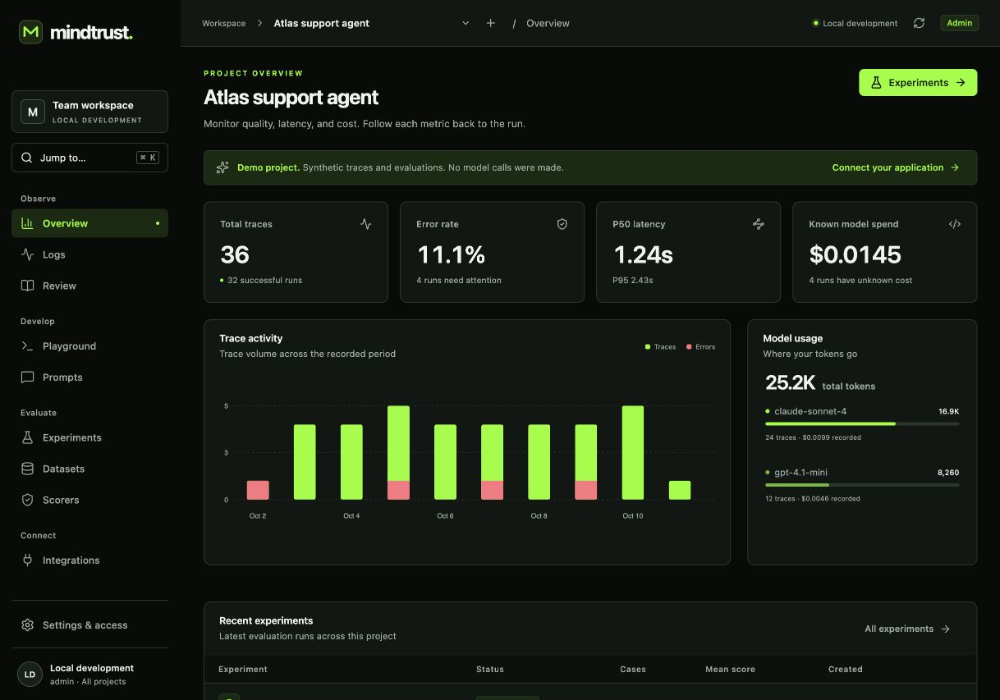

# Verus

**Open-source agent tracing and evaluations for any team, by [PreMan](https://preman.live).**

Verus is a standalone application for tracing agents, curating regression datasets, running evaluations, and comparing changes. Run it locally or self-host it for your team with your own accounts, API keys, and optional OIDC. **Standalone Verus does not require a PreMan account.**

Already using Braintrust? Connect supported versions of the existing JavaScript or Python SDK to Verus, then move your workflow using the [compatibility guide](docs/braintrust-compatibility.md) and [migration guide](docs/migration.md). Version **0.2 is a release candidate** with team access, scoped credentials, SDK contract tests, and backup/recovery tooling.

Verus was formerly named MindTrust. The repository name, `MindTrust` SDK class, `MINDTRUST_*` configuration, database filenames, and compatibility links retain their existing names so existing integrations continue to work.

The goal is a lower-cost, faster alternative. **Comparative cost and performance have not yet been established.** A representative customer pilot is required before claiming a production replacement for that team; this release does not claim universal Braintrust parity.



## Run locally

Requires **Git and Node.js 24 or newer**. Clone the repository, then start the local app:

```sh
git clone https://github.com/PreMan-Inc/MindTrust.git
cd MindTrust
npm ci
cp .env.example .env
npm run dev
```

Open **http://127.0.0.1:5190**. The API runs at **http://127.0.0.1:4310**. Data persists in `data/mindtrust.sqlite`.

The first start seeds an explicitly labeled synthetic workspace with traces, a dataset, two contrasting experiments, scorer definitions, prompt history, and review examples. It makes no model calls. Set `MINDTRUST_SEED=false` before the first start for an empty instance; that setting does not delete previously seeded data.

For the built app on a single port:

```sh
npm run build
npm start
```

Then open **http://127.0.0.1:4310**.

## What works

- **Projects and observability:** searchable, server-sorted trace tables with column controls, pagination, optional refresh, and a split inspector. Follow hierarchical span timelines, jump to failures, inspect structured JSON and metadata, and preserve unknown costs.
- **Dataset curation:** search and filter examples by tag and ground-truth presence, inspect inline, browse immutable version history, import/export JSON, and create cases from reviewed traces with explicitly chosen expectations.
- **Evaluations:** run real local agent functions or bounded Python processes through the SDK, or run echo/template tasks or a configured model provider, pin dataset revisions, snapshot scorer definitions, repeat trials, bound concurrency, inspect failures, cancel runs, and export results.
- **Experiment comparison:** choose an explicit baseline and candidate, filter regressions/improvements/mixed changes per metric, compare outputs side by side, and open underlying traces. Coverage and provenance warnings stay visible; missing scores remain missing.
- **Scorers:** exact match, containment, JSON validation, and a **model judge** that grades outputs against labels you define, with a per-run token budget. Judge reasons are kept on each case; an over-budget or unparseable judgment is a scorer error, never a pass. The Node SDK also executes custom scorer functions locally.
- **CI gate:** `GET /api/experiments/:id/gate` and `mindtrust gate` decide pass, fail, not comparable, or incomplete against score floors and a baseline. Only a complete, comparable run can pass.
- **Prompts and playground:** version prompt text, render input variables, test deterministic templates, and execute real model calls when a provider is configured.
- **Review:** save judgments, comments, and expected outputs against traces and evaluation cases. Human review does not rewrite automatic scores.
- **Integrations:** a dependency-free Node.js tracing/evaluation SDK and an OTLP/HTTP **JSON trace** receiver with parent relationships and retry-safe span IDs.
- **Team access:** named accounts, salted scrypt password hashes, optional OIDC, HttpOnly sessions, CSRF protection, viewer/editor/admin roles, project scopes, expiring/revocable API keys, and audit events.
- **Braintrust integration:** a versioned compatibility adapter exercised with the official SDK over real HTTP. See the [exact supported workflows and exclusions](docs/braintrust-compatibility.md).
- **Operations:** SQL-based trace pagination/aggregates, bounded evaluation scheduling, health/readiness probes, protected Prometheus metrics, redacted request logs, single-writer startup protection, and verified online backup/restore.

Use **Cmd/Ctrl+K** to find pages and switch projects. The console includes dense inspection tables, responsive navigation, prompt search, and direct overview-to-trace/experiment navigation. See the [console workflow guide](docs/console-workflows.md).

Everything displayed as sample activity is synthetic. User-created objects use the same persisted API and storage.

## Connect an application

Use the repository-local SDK; it is not published to npm yet. The example below runs from the repository root. In another application, point the import at your local SDK copy. Replace the project ID with one created in Verus, or use the seeded demo project for exploration.

```js
import { MindTrust } from './sdk/index.mjs';

const client = new MindTrust({
  baseUrl: 'http://127.0.0.1:4310',
  projectId: 'demo-project',
  apiKey: process.env.MINDTRUST_API_KEY,
});

await client.trace(
  'support-agent',
  { input: { request: 'Order status' }, kind: 'agent' },
  async (span) => {
    const order = await span.trace(
      'lookup-order',
      { kind: 'tool', input: { id: 'example-1' } },
      async () => ({ status: 'shipped' }),
    );
    return order;
  },
);

await client.flush();
```

Wrap an OpenAI or Anthropic client to record each model call as an `llm` span with its model, output, and token usage, nested under the current trace. Streaming calls are recorded once the stream has been consumed:

```js
import OpenAI from 'openai';
import { wrapOpenAI } from './sdk/index.mjs';

const openai = wrapOpenAI(new OpenAI(), client);
await client.trace('support-agent', async () =>
  openai.chat.completions.create({
    model: 'gpt-4.1-mini',
    messages: [{ role: 'user', content: 'Hi' }],
  }),
);
```

`wrapAnthropic(anthropic, client)` does the same for `messages.create`. Python applications can use the official Braintrust SDK's wrappers through the [compatibility adapter](docs/braintrust-compatibility.md).

`flush()` is explicit: await it before exiting or ending a short-lived request. Failed deliveries retain their batch for retry. Buffer overflow throws; if the task itself also failed, that original error is preserved and `client.lastLoggingError` records the logging failure. The native SDK is Node-only. The server also exposes the separately tested Braintrust compatibility adapter.

Run a complete local SDK evaluation example:

```sh
node examples/evaluate.mjs
```

This creates a separate synthetic project and dataset, executes six cases, records nested traces, and imports the scored experiment. For an authenticated instance, set `MINDTRUST_API_KEY`; for another server, set `MINDTRUST_URL`.

## Real agent evaluations

Verus includes runnable integrations for **LangGraph**, **PydanticAI**, **smolagents**, and **PreMan’s production shared agent loop**. These execute real model/tool loops against synthetic workspaces, retain nested traces and provider token usage, and score outcomes in the app. Deliberately broken tool results provide regression controls. See [the agent execution guide](docs/agent-evaluations.md), [public framework run evidence](docs/public-agent-evals.md), and [PreMan run evidence](docs/preman-agent-evals.md). The PreMan example requires an authorized PreMan backend checkout; the public framework examples do not.

The native SDK supports case/scorer deadlines, cancellation, subprocess termination, imported child spans, and retry-safe result delivery. The existing Braintrust SDK route supports the verified client-side workflows; agent code continues to run in your own environment. This is not a remotely hosted code sandbox or a claim that every Braintrust feature is supported.

## Add PreMan when you need it

[PreMan](https://preman.live) helps you generate and scale tests for agent workflows. You can evaluate their outputs in Verus through its SDK and dataset workflows. The [PreMan agent evaluation example](docs/preman-agent-evals.md) documents the existing runner, setup, and verified scope.

The hosted PreMan integration uses your existing PreMan login and selected workspace. Independent Verus installations use their own local accounts or OIDC unless an operator explicitly enables [PreMan workspace sign-in](docs/preman-shared-login.md).

## Gate a change in CI

After an evaluation, fail the build when the run is worse than its baseline or below a floor:

```sh
MINDTRUST_URL=https://verus.example.com MINDTRUST_API_KEY=... \
  node sdk/cli.mjs gate <experimentId> --baseline <baselineId> --min-score "Exact match=0.9"
```

It exits `0` (pass), `1` (fail), `2` (incomplete, or not comparable with the baseline) or `3` (no decision could be reached). Add `--json` for the full decision. From code, use `client.gate(experimentId, { baselineId, minScores })`.

## Real model calls

Set `OPENAI_API_KEY` and, optionally, `OPENAI_BASE_URL` in the server’s `.env`, then restart. Select the provider task in Playground or an evaluation. Credentials stay on the server. The integration uses the OpenAI-compatible, non-streaming chat-completions shape; compatibility with every provider/model is not implied.

Provider tokens are recorded when supplied. Dollar cost remains unknown unless instrumentation explicitly reports it. Local template/echo tasks make no provider calls; a zero model charge does not mean zero infrastructure cost.

## OpenTelemetry

Send an OTLP/HTTP JSON payload to:

```text
POST http://127.0.0.1:4310/v1/traces
Content-Type: application/json
Authorization: Bearer <key-if-enabled>
x-mindtrust-project-id: <project-id>
```

The receiver accepts `resourceSpans` / `scopeSpans`, preserves trace/span IDs and parentage, and retains attributes. It does **not** support protobuf, gRPC, the logs/metrics signals, or Braintrust’s `x-bt-parent` routing. Standard exporters often default to protobuf; select JSON explicitly or adapt the payload.

## Authentication and deployment

Local development is unauthenticated by default and binds loopback. Set `MINDTRUST_ADMIN_TOKEN` to enable authentication. Select **Initial setup or developer token** on the sign-in screen, enter that token, and create a named administrator under **Settings → Team**. Daily access uses local accounts or your configured OIDC provider; applications use scoped, expiring keys. Team administration and audit history live in **Settings & access**. PreMan sign-in is optional and disabled by default.

Production mode requires a bootstrap secret of at least 32 characters and exact HTTPS `MINDTRUST_ALLOWED_ORIGINS`. It enables Secure session cookies and disables new demo seeding in the entry point. The supplied hosted topology uses Caddy for TLS and a private application network, with a separate service/volume/secrets per customer.

A Dockerfile and Compose configurations are included. For self-hosting over HTTPS, use `deploy/compose.production.yaml`, which includes Caddy. Fill an operator-managed environment file from `deploy/production.env.example`, then:

```sh
docker compose --env-file /secure/customer.env -f deploy/compose.production.yaml -p customer-workspace up --build -d
```

The root `compose.yaml` runs the production application behind a loopback HTTP port and requires your own HTTPS reverse proxy with the configured allowed origin. It is not a browser-ready local quickstart; use the Node.js instructions above for local development.

See the [production runbook](docs/production-operations.md) for DNS, TLS, identity provisioning, backups, monitoring, upgrades, and rollback. Each workspace has one writer; do not scale API replicas over a shared SQLite file. Cloud provisioning, offsite backup scheduling, and a live production rollout are operator tasks, not services automatically created by these files.

## Verify

```sh
npm run check
```

The suite exercises persistence, snapshots, official SDK contracts, scoped access, session/CSRF security, signed OIDC flows with a mock issuer, recovery, concurrency, and provider/OTLP behavior. CI also builds and smoke-tests the production container. No paid model credentials are needed. See [release evidence](docs/release-0.2.md), [SDK contracts](docs/braintrust-compatibility.md), and the [local synthetic benchmark](docs/benchmark-local.json).

For development setup, focused checks, and contribution guidance, see [CONTRIBUTING.md](CONTRIBUTING.md).

## License

Verus is available under the [Apache License 2.0](LICENSE). See [NOTICE](NOTICE) for project attribution.

## Research and design

- [Braintrust research](docs/braintrust-research.md): primary-source product inventory, public API/SDK behavior, architecture, parity requirements, and benchmark methodology.
- [API contract](docs/api-contract.md): routes and payload shapes.
- [Architecture](docs/architecture.md): implementation choices, comparison/cost semantics, and operational boundaries.
- [Migration guide](docs/migration.md): field coverage and a staged migration procedure.
- [Production runbook](docs/production-operations.md): customer isolation, operations, backup/restore, and release boundaries.
- [Braintrust compatibility](docs/braintrust-compatibility.md): pinned official SDK workflows and unsupported features.

## What remains before a full replacement

This release does not include Brainstore/general SQL or BTQL, full Braintrust API/SDK compatibility, distributed storage or workers, remote code sandboxes, online scoring automations, streaming/multi-provider gateway routing, attachments, alerts, assigned/blinded human-review queues, Loop/Topics/Patterns, SAML/SCIM, or high availability. OIDC, project-scoped roles, and audit events are implemented; compliance certification and independent penetration testing are not established. The research document describes the wider product requirements.

The practical next step is to dual-run a real customer workflow and measure identical workloads for correctness, end-to-end latency, total cost, and operational reliability. Do not retire an existing service on the basis of synthetic demo results.
